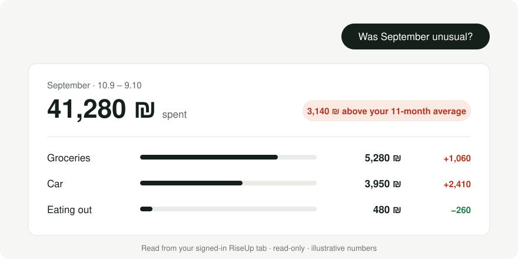
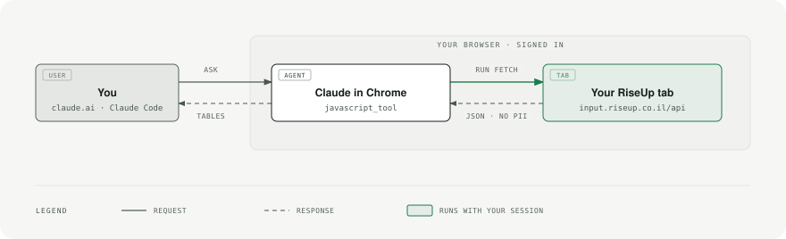

# riseup-skill

Ask Claude about your [RiseUp](https://input.riseup.co.il) money. It answers from the RiseUp tab you're already signed into.

<picture>
  <source media="(prefers-color-scheme: dark)" srcset="assets/hero-dark.svg">
  
</picture>

```
/plugin marketplace add kaminskypavel/riseup-skill
/plugin install riseup-skill@riseup-skill
```

Needs Google Chrome with [Claude in Chrome](https://claude.ai/chrome), and RiseUp signed in there.
Other installs: `./install.sh` (personal skill) or `./build.sh` → upload `dist/riseup-skill.zip` in the Claude app.

## Why a skill, not a CLI

- **Nothing to install or log into.** No Node, no headless browser, no separate Google sign-in.
- **No session file on disk.** A CLI has to save your live RiseUp cookies somewhere. This reuses the tab you already have open and never copies the session out.
- **Works where you talk to Claude** — the Claude app, desktop or Claude Code — not just a terminal.
- **Claude does the analysis in the tab.** It pulls exactly the months and fields a question needs, so "why was September negative?" is one question, not five commands.

<picture>
  <source media="(prefers-color-scheme: dark)" srcset="assets/how-it-works-dark.svg">
  
</picture>

## Safe by default

Reads run automatically. Anything that changes RiseUp — reclassify, rename, exclude, merge — is shown as a before/after table first and runs only after you say yes. Account numbers, IBANs and card numbers are stripped before Claude sees a response.

Facts only you know (what a recurring check is for, which card pays for fuel) go in `skills/riseup-skill/local-notes.md`. It's gitignored.

## Good to know

- Budget months start on your cashflow day, not the 1st. Answers state the date range.
- RiseUp only sees connected accounts, so some totals can be partial. Claude says when.
- RiseUp's API is private and can change without notice.
